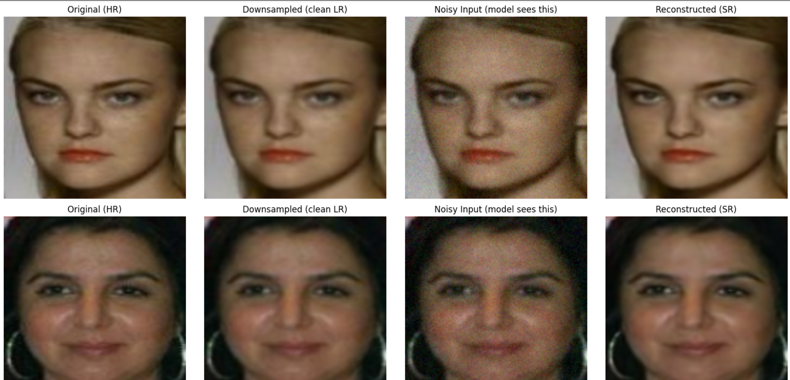
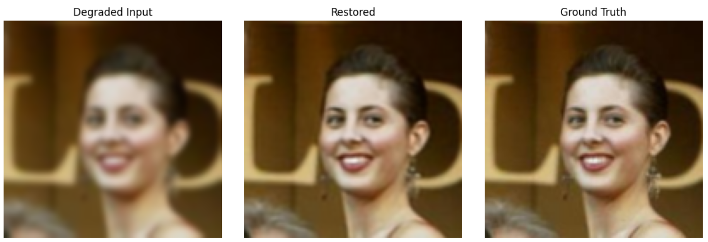

# Face Image Restoration with U-Net

This project was developed as the final project for the Machine Learning Fundamentals course. It presents a deep-learning pipeline for restoring degraded facial images using a U-Net-based convolutional architecture.A U-Net-style convolutional network is trained on aligned faces from the **CelebA** dataset and evaluated both in-distribution and on the independent **LFW** dataset.

The model learns to reconstruct clean, high-resolution faces from inputs affected by resolution reduction, Gaussian noise, and blur while also preserving facial identity.

## Project Objective

The restoration task maps a degraded facial image to a clean reference image:

$$
I_{degraded} \longrightarrow f_{\theta}(I_{degraded}) \approx I_{clean}
$$

The implementation addresses four main objectives:

- Detect and align facial images before training
- Generate realistic degraded inputs from clean faces
- Restore visual details through an encoder-decoder network
- Evaluate reconstruction quality and identity preservation

## Datasets

| Dataset | Purpose | Images used |
|---|---|---:|
| CelebA | Face alignment, training, and validation | 202,599 source images processed |
| LFW | Cross-dataset generalization test | 13,233 images |

Faces from CelebA are detected and aligned with **MTCNN** at a resolution of 128 × 128. After alignment, 80% of the available images are assigned to training and 20% to validation. The recorded training subset contains **161,845 images**.

## Data Preparation

| Stage | Configuration |
|---|---|
| Face detection and alignment | MTCNN, output size 128 × 128, margin 20 |
| Downsampling | Random factor of 1.2 or 1.4, followed by bilinear upsampling |
| Gaussian noise | Standard deviation 0.03, applied with probability 0.5 |
| Blur | Kernel size 7, applied with probability 0.3 |
| Pixel range | Clamped to [0, 1] |

The notebook also defines horizontal flipping, small rotations, and brightness/contrast changes as possible augmentation operations.

## Model Architecture

The restoration model follows a compact U-Net design with three encoder stages and two decoder stages. Skip connections transfer spatial information from the encoder to the corresponding decoder layers.

| Component | Configuration |
|---|---|
| Encoder block 1 | Two convolutions, 3 → 64 channels |
| Encoder block 2 | Two convolutions, 64 → 128 channels |
| Bottleneck | Two convolutions, 128 → 256 channels |
| Decoder block 1 | Upsampling and skip connection, output 128 channels |
| Decoder block 2 | Upsampling and skip connection, output 64 channels |
| Output layer | 1 × 1 convolution with sigmoid activation |

All internal convolutional layers use 3 × 3 kernels, padding, and ReLU activation. Max pooling reduces spatial resolution in the encoder, while interpolation restores it in the decoder.

## Training Strategy

| Parameter | Value |
|---|---|
| Optimizer | Adam |
| Learning rate | 1 × 10⁻⁴ |
| Epochs | 7 |
| Batch size | 16 |
| Mixed precision | CUDA automatic mixed precision |
| Checkpoint criterion | Highest validation PSNR |

The training objective combines pixel-level reconstruction and identity preservation:

$$
\mathcal{L}_{total}
=
\mathcal{L}_{L1}
+
0.1\,\mathcal{L}_{identity}
$$

The reconstruction term measures the absolute pixel difference between restored and reference images. The identity term compares embeddings produced by a pretrained **InceptionResnetV1** model trained on VGGFace2.

## Validation Performance

| Epoch | PSNR (dB) | SSIM | Embedding distance |
|---:|---:|---:|---:|
| 1 | 35.71 | 0.9602 | 0.1345 |
| 2 | 37.54 | 0.9705 | 0.1026 |
| 3 | 37.82 | 0.9737 | 0.0931 |
| 4 | 38.66 | 0.9756 | 0.0864 |
| 5 | 39.00 | 0.9766 | 0.0822 |
| 6 | 38.98 | 0.9764 | 0.0836 |
| 7 | **39.55** | **0.9783** | **0.0780** |

Reconstruction quality improves consistently during training. PSNR and SSIM increase, while embedding distance decreases, indicating better visual recovery together with stronger preservation of facial identity.

## CelebA Reconstruction Results

The examples compare the original face, clean low-resolution image, degraded model input, and final reconstruction. The network removes much of the injected noise and recovers a smoother image that remains close to the original facial structure.

## Cross-Dataset Evaluation

Generalization is evaluated on LFW without retraining the model.

| Metric | LFW result |
|---|---:|
| PSNR | **36.8777 dB** |
| SSIM | **0.9767** |
| Embedding distance | **0.1049** |

The restored LFW example recovers sharper facial details from the degraded input and remains visually close to the ground-truth image. The high SSIM and relatively low embedding distance show that the model transfers effectively to faces outside the CelebA training distribution.
